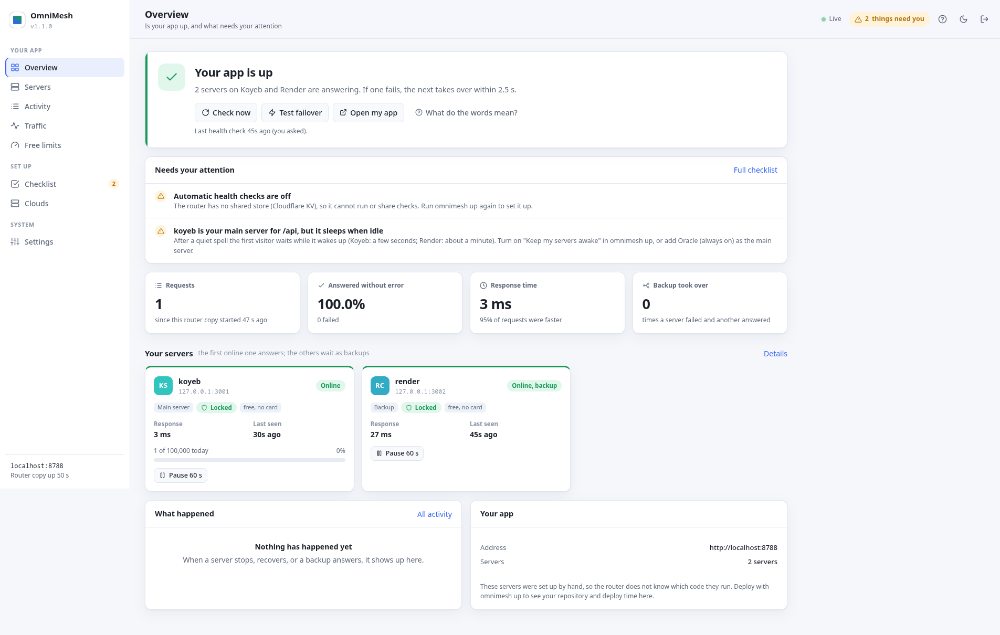
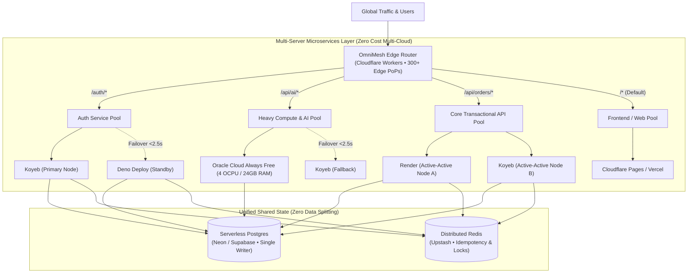
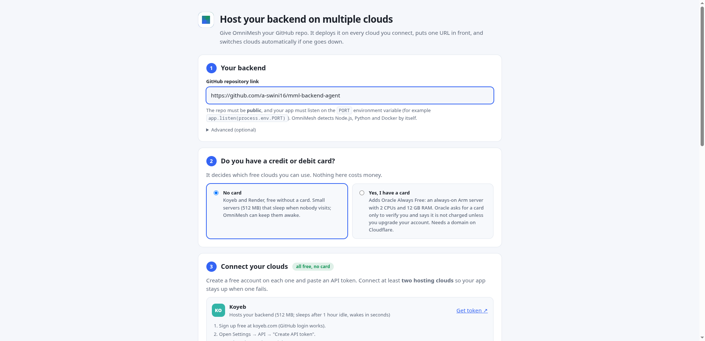
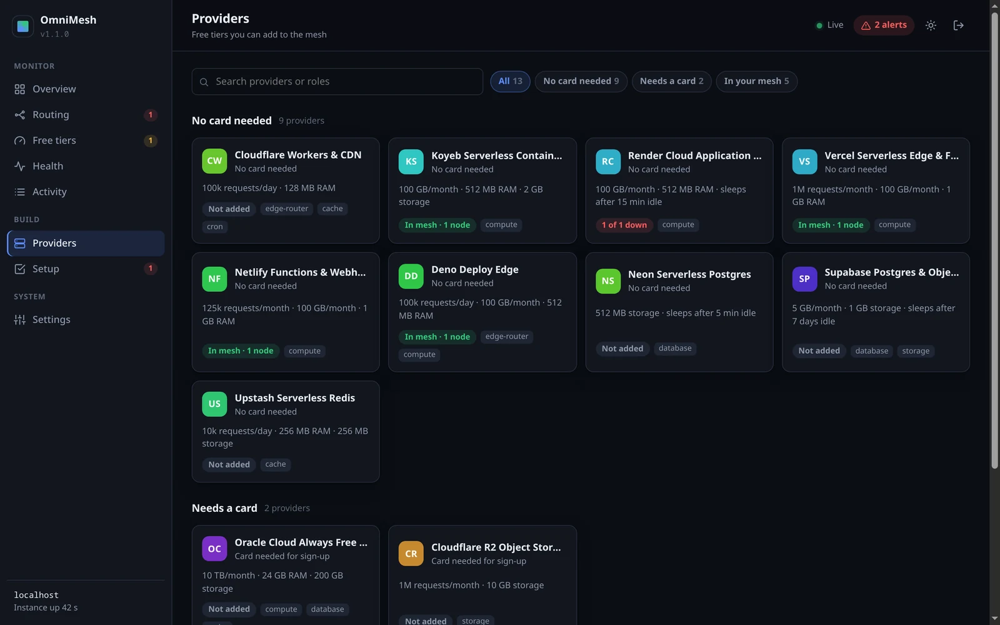
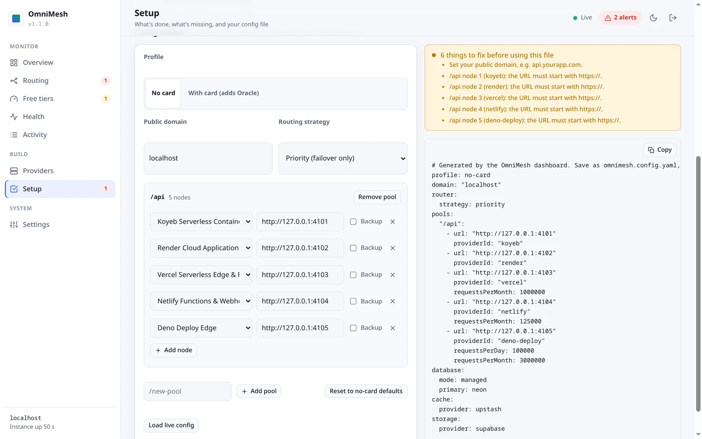
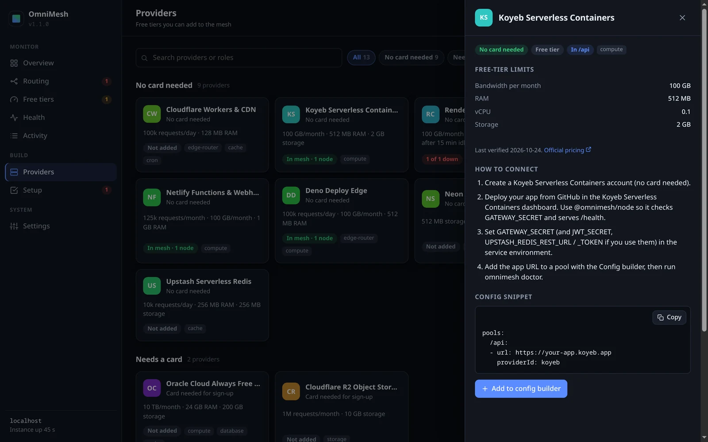
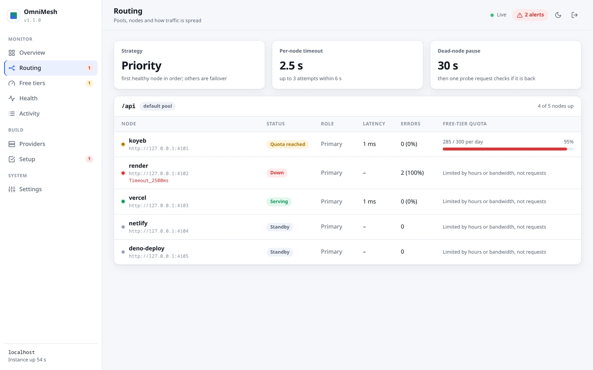

<div align="center">


# OmniMesh

### The open-source AWS alternative: scale microservices across multiple clouds with sub-3s auto-failover.

**One domain. Multiple clouds. Sub-3s auto-failover. Zero AWS bills.**

[](https://github.com/a-swini16/omnimesh/actions/workflows/ci.yml)
[](LICENSE)
[](docs/zero-card-guide.md)
[](#why-omnimesh)
[](tsconfig.base.json)
[](#tested-under-load)
[](CONTRIBUTING.md)

[Quick start](#quick-start) · [Microservices architecture](#multi-server-microservices-how-it-works) · [Dashboard](#the-dashboard) · [How it works](#how-it-works) · [Honest limits](#honest-limits) · [No-card guide](docs/zero-card-guide.md)

<br/>



*Live Operator Dashboard: real-time telemetry, active multi-cloud node health, sub-3s failover state, and automatic quota tracking.*

</div>

---

## What OmniMesh does for you

1. **You give it your backend's GitHub link.**
2. **It hosts your microservices across several free clouds at once and gives you one unified domain.**
3. **If a server crashes, sleeps, or runs out of free quota, another server answers in <2.5 seconds.** Your users never notice.

<!-- STATUS:START -->
**Works today**
- `omnimesh up`: interactive setup wizard that deploys a public GitHub repo (Node.js, Python, or Docker) to Koyeb and Render, puts the edge router on Cloudflare in front, and gives you one live production URL. Run it again to redeploy.
- Multi-server microservice routing: path-based dispatching (`/auth`, `/api/ai`, `/api/orders`, `/`) across independent server pools.
- Automatic sub-3s failover, predictive switching at 95% quota, safe retries for financial writes, rate limiting.
- Live Operator Dashboard with 1-click token auto-login (`omnimesh open`).

**Coming next**
- Background health checks with zero user traffic, a safe "pause one server" chaos test, and a lock indicator.
- More clouds deployed for you: Vercel, Oracle Cloud Always Free (24 GB RAM / 4 OCPUs); free databases on Neon and Upstash.
- `omnimesh destroy`, and `npx omnimesh` once published to npm.
<!-- STATUS:END -->

---

## Why OmniMesh

To run resilient, multi-server microservices on AWS, you are forced to configure:
- **Route 53 Hosted Zone** ($0.50/mo + query costs)
- **Application Load Balancer (ALB)** ($25–$40/mo + LCU charges)
- **Target Groups & Rules** routing path prefixes to ECS Tasks or EC2 clusters
- **NAT Gateway** ($32/mo + $0.045/GB data processing)
- **CloudWatch Alarms & Dashboards** ($10–$50/mo)

**You easily pay $150–$500/month before processing meaningful traffic.** And if AWS `us-east-1` has an outage, your entire microservice mesh goes down with it.

If you opt for a single free-tier VPS, it sleeps after 15 minutes of inactivity, runs out of memory on spikes, or fails silently at 3 AM.

**OmniMesh gives you the architecture of a multi-AZ AWS deployment distributed across independent cloud providers for $0/month.**

| Feature | AWS Architecture | Single Free VPS | **OmniMesh Multi-Cloud Mesh** |
| :--- | :--- | :--- | :--- |
| **Monthly cost** | $150 – $500+/mo | $0 | **$0 / month** |
| **Credit card required** | Required | Sometimes | **Not required** (no-card mode) |
| **Server failure / crash** | Multi-AZ (expensive) | App is down (502) | **Next server answers after 2.5s timeout** |
| **Free quota exhausted** | Pay-as-you-go bill shock | App halts (429) | **Predictively shifts to next cloud at 95%** |
| **Multi-server microservices** | ALB + ECS Target Groups | Manual Nginx configs | **Built-in path-prefix routing per pool** |
| **Financial write safety** | Custom SQS/DynamoDB locks | None (double billing risk) | **Idempotency-Key in shared Redis** |
| **Operations observability** | CloudWatch ($$$) | Provider console tabs | **One live unified Operator Dashboard** |
| **Free scale ceiling** | 0 requests free | Quota of single VPS | **~100,000 requests/day** ([honest limits](#honest-limits)) |

---

## Multi-Server Microservices: How It Works

Just like AWS Application Load Balancers route path patterns to dedicated **Target Groups**, OmniMesh's global edge router dispatches traffic based on path prefixes to **dedicated server pools across multiple clouds**.

### Distributed Architecture



### Path-Based Routing Configuration

Defining multiple microservice servers in `omnimesh.config.yaml` is clean and declarative:

```yaml
profile: no-card
domain: api.yourdomain.com
router:
  timeoutMs: 2500
  maxAttempts: 3
  totalBudgetMs: 6000
  circuitTtlMs: 30000

defaultPool: /

pools:
  # Microservice 1: Authentication & User Accounts (Instant cold starts)
  /auth:
    - url: https://auth-service.koyeb.app
      providerId: koyeb
      weight: 2
    - url: https://auth-service.deno.dev
      providerId: deno
      weight: 1
      isBackup: true

  # Microservice 2: Heavy Compute & AI / RAG Pipeline
  /api/ai:
    - url: https://oracle-instance.yourdomain.internal:8080
      providerId: oracle       # 4-core, 24GB RAM Always Free
      weight: 1
    - url: https://ai-fallback.koyeb.app
      providerId: koyeb
      weight: 1
      isBackup: true

  # Microservice 3: Core Transactional API (Active-Active load balancing)
  /api/orders:
    - url: https://orders-node-a.onrender.com
      providerId: render
      weight: 1
      keepAwake: true
    - url: https://orders-node-b.koyeb.app
      providerId: koyeb
      weight: 1

  # Default Pool: Web App / Frontend SPA
  /:
    - url: https://frontend-spa.pages.dev
      providerId: cloudflare
      weight: 1
```

### Why Multi-Server Microservices on OmniMesh Win

1. **Zero Blast Radius:** If your AI microservice on Oracle runs out of RAM or times out, your Auth microservice on Koyeb and Checkout on Render continue operating at full speed.
2. **Sub-3s Automatic Circuit Breaking:** If any node throws `502`–`504` or exceeds 2.5s, the edge router immediately forwards the request to the next server in the pool and opens a 30-second circuit breaker on the failing node.
3. **No Double-Charging:** Retries for non-idempotent operations (POST/PATCH) require an `Idempotency-Key` verified against shared Upstash Redis. Failover never executes a payment or order twice.
4. **Single-Writer Database Integrity:** All servers connect to one shared serverless Postgres (Neon or Supabase). No split-brain, no data synchronization nightmares.

---

## Quick start

### Host your backend across multiple servers in 3 steps

You need: a backend in a **public GitHub repo** that listens on `PORT` (e.g. `app.listen(process.env.PORT)`).

```bash
git clone https://github.com/a-swini16/omnimesh.git && cd omnimesh && pnpm install
node packages/cli/bin/omnimesh.js up
```

<div align="center">
<br/>



*Interactive Setup Wizard: Connect your GitHub repo, link free cloud providers, and deploy your multi-server mesh in 60 seconds.*

</div>

1. **Paste your GitHub repo link.** OmniMesh automatically detects Node.js, Python, or Docker.
2. **Connect your clouds.** Create a free account on Koyeb, Render, and Cloudflare (no credit card needed) and paste one API token for each. The wizard links directly to where each token is generated.
3. **Click Deploy.** OmniMesh builds and deploys your service across each cloud, sets up the Cloudflare edge router in front, validates health checks, and gives you **one live production URL** and your **Live Operator Dashboard**.

To deploy updates, simply run `node packages/cli/bin/omnimesh.js up` again and click **Redeploy latest code**.

### CLI Commands Reference

| Command | What it does |
| :--- | :--- |
| `omnimesh up` | **Start here.** Web setup wizard: input repo, connect clouds, deploy or redeploy |
| `omnimesh open` | Opens your Operator Dashboard, already authenticated |
| `omnimesh token [--rotate]` | Displays your dashboard sign-in key, or rotates it on the live router |
| `omnimesh deploy` | Headless redeploy: builds and rolls out latest code to all clouds |
| `omnimesh chaos` | Real-world failover drill: pauses the active node, verifies another cloud answers, resumes node |
| `omnimesh status` | Live terminal telemetry: health, latency, and status for every node |
| `omnimesh doctor` | Validates configuration, inspects gateway secrets, and warns of weak settings |
| `omnimesh init` / `add-provider` | Manual headless setup if you manage servers directly and want the router layer |

---

## The dashboard

The router serves a real-time Operator Dashboard at `https://<your-domain>/_omnimesh/dashboard`. Sign in with your status token or open directly via `omnimesh open`.

| Providers: what to add, card or no card | Setup: checklist and config builder |
| :---: | :---: |
|  |  |
| **Connection guide for each provider** | **Routing: every pool and node** |
|  |  |

Dashboard features:
- **Real-Time Mesh Health:** live latency graphs, active vs. backup nodes, circuit breaker states.
- **Quota Utilization Gauges:** live request counting against each cloud's monthly allowance.
- **Failover Logs:** audit trail of every timeout, reroute, and recovery event.
- **Strict Security:** zero external scripts, zero CDNs, locked down by strict Content Security Policy (CSP), returning 404 without the operator token.

---

## Tested under load

The mock mesh tests 5 mock providers behind the real router under heavy k6 load. These figures demonstrate **router behavior** under adverse real-world conditions. Reproduce with `benchmarks/mock-mesh/run.sh <scenario>`.

| Scenario | Result |
| :--- | :--- |
| **Flash sale: 500 buyers, primary writes and times out** | **0 duplicate orders, 0 missing records** |
| **Primary dies at 100 req/s** | **4,001/4,001 succeeded**; only the 250 in-flight requests waited one timeout |
| **Every node down, then recovered** | Clean `503` within 6s budget; immediate recovery when nodes returned |
| **Free quota reached + provider returning 429** | **3,000/3,000 succeeded**; traffic smoothly shifted to next free tier |
| **Oversized payload, malformed JSON, buggy route** | `413` / `400` on first attempt; healthy nodes retained in rotation |
| **44,725 authenticated profile requests** | 0 cross-user leakages, 0 cacheable private responses |

---

## Supported Providers

Free-tier limits are codified in each provider's `limits.json` file with a verified date and link to the official pricing page.

| Provider | Role | Card | Free tier (as verified) |
| :--- | :--- | :---: | :--- |
| [Cloudflare Workers](https://developers.cloudflare.com/workers/platform/pricing/) | Edge Router, KV, rate limiting | No | 100,000 requests/day |
| [Koyeb](https://www.koyeb.com/docs/reference/instances) | Microservice compute | No | 1 service, 512 MB RAM, 0.1 vCPU; sleeps after 1 h idle |
| [Render](https://render.com/docs/free) | Microservice compute | No | 512 MB, 0.1 CPU, 750 h/month per workspace; sleeps after 15 min idle |
| [Vercel](https://vercel.com/docs/limits/fair-use-guidelines) | Compute (burst) | No | 1M function invocations, 100 GB/month |
| [Netlify](https://www.netlify.com/pricing/) | Webhooks, functions | No | 300 credits/month |
| [Deno Deploy](https://deno.com/deploy/pricing) | Auth, light compute | No | 1M requests, 20 GiB egress/month |
| [Neon](https://neon.com/pricing) / [Supabase](https://supabase.com/pricing) | Postgres (single writer) | No | 1 GB storage / 500 MB database |
| [Upstash](https://upstash.com/docs/redis/overall/pricing) | Redis (idempotency & rate limits) | No | 500K commands/month, 250 MB |
| [Oracle Cloud](https://docs.oracle.com/en-us/iaas/Content/FreeTier/freetier_topic-Always_Free_Resources.htm) | Heavy compute (always-on) | **Yes** | 4 Arm OCPUs, 24 GB RAM, 200 GB storage, 10 TB/month out |
| [Cloudflare R2](https://developers.cloudflare.com/r2/pricing/) | S3-compatible file storage | **Yes** | 10 GB storage, zero egress fees |

*Note: Use one legitimate personal account per provider. OmniMesh is designed to work within legitimate free allowances, not bypass them.*

---

## Security

- **Fail-Closed Gateways:** the router and backend nodes refuse to boot without a strong cryptographic gateway secret, and plain HTTP upstreams are rejected.
- **Hidden Backends:** client-supplied gateway headers are stripped, backend URLs never leak in responses, and operator endpoints return 404 without the status token.
- **Zero Cross-User Caching:** responses to authenticated users are tagged `private, no-store` with `Vary`, ensuring shared caches never serve sensitive user data.
- **Strict Cryptographic JWTs:** signature algorithms are pinned, `exp` is strictly enforced with bounded clock skew, and optional `iss`/`aud` validation.
- **Audited Architecture:** see [docs/audit/AUDIT_REPORT.md](docs/audit/AUDIT_REPORT.md) and [SECURITY.md](SECURITY.md).

---

## Honest limits

Open-source projects that overpromise get shredded on Hacker News. Here is what OmniMesh does **not** do:

1. **It is not AWS at enterprise scale for free.** Free tiers have real CPU and RAM constraints. OmniMesh keeps your app online when one server dies; it does not turn 512 MB into 512 GB.
2. **The free ceiling is ~100,000 requests/day (~3M/month).** Every request runs through the Cloudflare Worker router. Adding compute providers adds CPU and RAM, not router requests. Beyond 100k req/day, upgrade to Cloudflare Workers Paid ($5/mo for 10M requests) with zero code changes.
3. **The database is a single writer.** Exactly one database accepts writes to guarantee ACID consistency and prevent data splitting. If your Postgres provider is down, write requests fail until it recovers.
4. **WebSockets do not fail over mid-packet.** If a server drops, WebSocket clients reconnect and immediately land on a healthy node.
5. **Cold starts exist on free tiers.** Render and Koyeb sleep when idle. Keep-alive pings can maintain warm instances where provider terms permit.

---

## Project layout

```
packages/
  router/      Edge router: failover, microservice pools, quotas, rate limits, dashboard (Cloudflare Worker / Node)
  node/        Middleware for your backend: gateway secret, JWT, idempotency, health checks
  core/        Config schema, validation, and shared routing helpers
  cli/         The omnimesh command: interactive setup wizard and operational tooling
  providers/   Provider adapters + verified limits.json files
examples/      rest-api, auth-service, webhooks
benchmarks/    Mock mesh + k6 load and chaos testing scenarios
docs/          Architecture, no-card guide, security audit report
```

---

## Contributing

New cloud provider adapters are the fastest way to contribute: copy [`packages/providers/_template`](packages/providers/_template), populate `limits.json` from the provider's official documentation, and add a test. See [CONTRIBUTING.md](CONTRIBUTING.md).

---

## License

[MIT](LICENSE) © 2026 OmniMesh contributors
