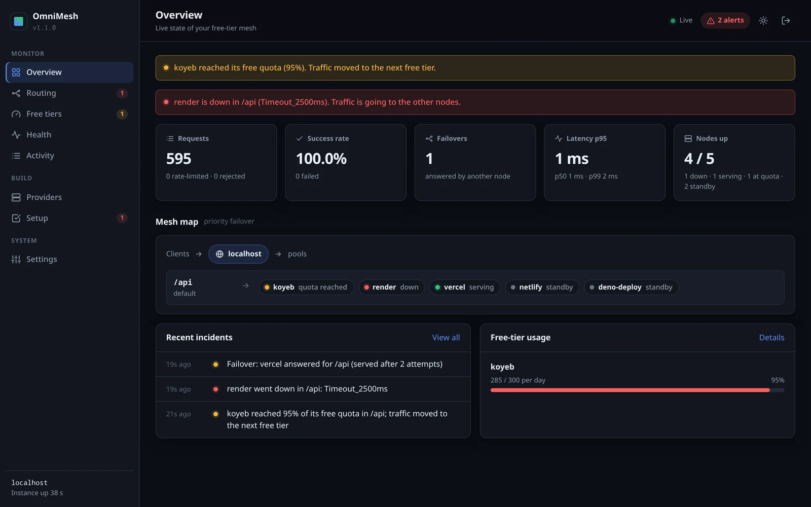
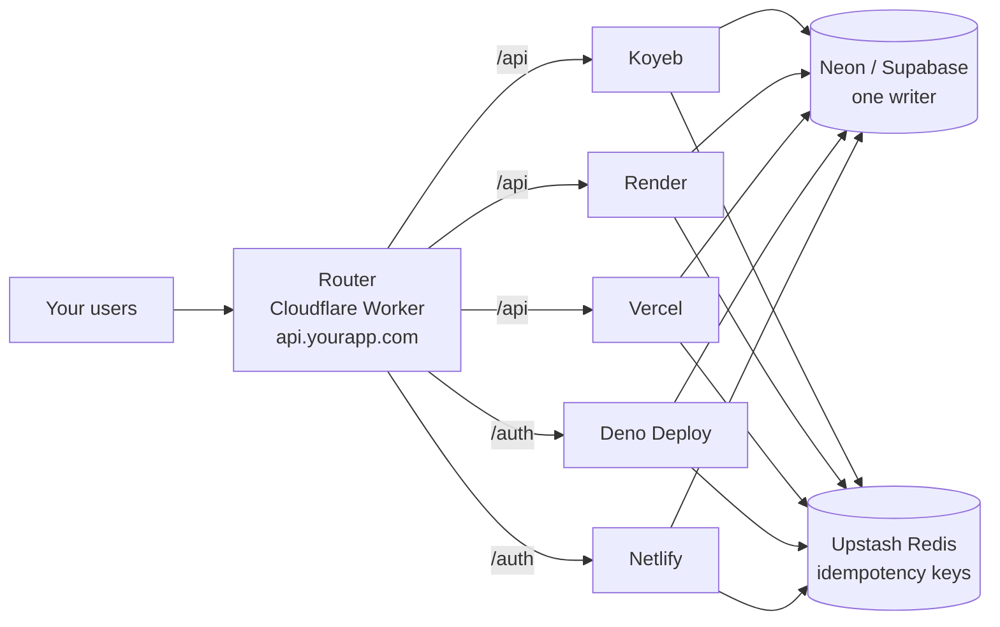

<div align="center">


# OmniMesh

### The open-source AWS alternative: scale across multiple clouds with sub-3s auto-failover.

**One domain. Many clouds. Sub-3s auto-failover. Zero vendor lock-in.**

[](https://github.com/a-swini16/omnimesh/actions/workflows/ci.yml)
[](LICENSE)
[](docs/zero-card-guide.md)
[](tsconfig.base.json)
[](#tested-under-load)
[](CONTRIBUTING.md)

[Quick start](#quick-start) · [Dashboard](#the-dashboard) · [How it works](#how-it-works) · [Honest limits](#honest-limits) · [No-card guide](docs/zero-card-guide.md)



</div>

---

## What OmniMesh does for you

1. **You give it your backend's GitHub link.**
2. **It hosts your backend on several free clouds at once and gives you one URL.**
3. **If a cloud goes down or runs out of free quota, another one answers.** Your users don't notice.

<!-- STATUS:START -->
**Works today**
- `omnimesh up`: a setup page that deploys a public GitHub repo (Node.js, Python or Docker) to Koyeb and Render, puts the router on Cloudflare in front, and gives you one URL. Run it again to redeploy.
- Automatic failover, switching before free limits run out, safe retries for payments, rate limits.
- A live dashboard you open already signed in (`omnimesh open`).

**Coming next**
- Health checks with no traffic, a safe "pause one server" failover test, and a lock indicator.
- More clouds deployed for you: Vercel, Oracle Cloud Always Free; free databases on Neon and Upstash.
- `omnimesh destroy`, and `npx omnimesh` once published to npm.
<!-- STATUS:END -->

## Why OmniMesh

AWS is powerful, but complex, expensive, and locks you into a single vendor. Running resilient infrastructure shouldn't require thousands of dollars in cloud bills or a team of DevOps engineers.

**OmniMesh puts one unified router in front of multiple cloud tiers.** It does for backend infrastructure what [OmniRoute](https://github.com/cheaper-inference/OmniRoute) does for AI models: one entry point, resilient multi-cloud federation, and instantaneous automatic failover.

|  | AWS | One free tier | **OmniMesh** |
| :--- | :--- | :--- | :--- |
| Monthly cost | Pay as you go | $0 | **$0** |
| Credit card | Required | Sometimes | **Not required** (no-card mode) |
| A server dies | Multi-AZ, if you pay for it | Your app is down | **Next node answers after one 2.5 s timeout** |
| Free limit reached | — | Errors (429) | **Moves to the next free tier at 95%** |
| Operations view | CloudWatch | One console per provider | **One live dashboard** |
| Scale ceiling | Very high | That provider's quota | **~100,000 requests/day** on free plans ([why](#honest-limits)) |

OmniMesh is how you ship for $0 and stay online. When you outgrow free tiers, move the same setup to paid plans; your code doesn't change.

## Features

- **Automatic failover:** every request goes to a healthy node. Timeouts, crashes and `502`–`504` open a circuit for 30 s, after which one probe request checks whether the node is back.
- **Uses every free tier:** each node knows its provider's free quota, and traffic moves to the next free tier at 95%, before users ever see a `429`.
- **No-card mode:** `omnimesh init --no-card` builds the whole mesh from providers that need no card. Oracle Cloud and R2 are added only if you have one.
- **Safe retries:** writes are retried only with an `Idempotency-Key`, stored in shared Redis, so a failover never charges a customer twice.
- **Locked-down backends:** nodes reject anything without the router's secret, in constant time, and the secret can be rotated with zero downtime.
- **Weighted load balancing and backup-only nodes**, per pool (`/api`, `/auth`, `/webhooks`, …).
- **Live dashboard:** a mesh map, quota bars, incidents, a provider catalog with connection guides, and a config builder.
- **Tested under load:** 99 automated tests, plus six k6 scenarios against a local mock mesh.

## The dashboard

The router serves an operator dashboard at `https://<your-domain>/_omnimesh/dashboard`. Sign in with `OMNIMESH_STATUS_TOKEN`. Every number on it is live data from your router.

| Providers: what to add, card or no card | Setup: checklist and config builder |
| :---: | :---: |
|  |  |
| **Connection guide for each provider** | **Routing: every pool and node** |
|  |  |

Pages: **Overview**, **Routing**, **Free tiers**, **Health**, **Activity**, **Providers**, **Setup**, **Settings**. The page makes no outside requests and is served with a strict Content Security Policy. If no status token is set, it returns 404.

## How it works



1. A request arrives at your one domain. The router picks a healthy node in the matching pool and adds the gateway secret.
2. If that node times out (2.5 s), refuses the connection or answers `429`/`502`–`504`, the router tries the next node, up to 3 attempts within a 6 s budget, and skips the dead node for 30 s.
3. A node close to its free quota is skipped until the quota resets.
4. Every node runs the same stateless app and shares one database and one Redis, so any node can answer any request.

## Quick start

### Host your backend in 3 steps

You need: a backend in a **public GitHub repo** that listens on the `PORT` environment variable (for example `app.listen(process.env.PORT)`).

```bash
git clone https://github.com/a-swini16/omnimesh.git && cd omnimesh && pnpm install
node packages/cli/bin/omnimesh.js up
```

A setup page opens in your browser:

1. **Paste your GitHub repo link.** OmniMesh detects Node.js, Python or Docker by itself.
2. **Connect your clouds.** Create a free account on Koyeb, Render and Cloudflare (no credit card) and paste one API token for each. The page shows exactly where to click for each token.
3. **Click Deploy.** OmniMesh builds your backend on every cloud, puts the router on Cloudflare in front, checks that it answers, and gives you **one URL** for your app plus the **dashboard** to manage it.

To ship new code, run `omnimesh up` again and click **Redeploy latest code**. Every cloud gets the update, and your URL and secrets stay the same.

> Why paste tokens at all? Each cloud requires you to own your account. That's the only manual part; OmniMesh does everything after it.

### All commands

| Command | What it does |
| :--- | :--- |
| `omnimesh up` | **Start here.** Setup page: give your GitHub repo, connect clouds, deploy or redeploy |
| `omnimesh open` | Opens your dashboard, already signed in |
| `omnimesh token [--rotate]` | Shows your dashboard sign-in key, or replaces it on the live router |
| `omnimesh deploy` | Redeploys the latest code to every cloud (no page needed) |
| `omnimesh status` | Live health and latency for every node |
| `omnimesh doctor` | Finds weak or missing secrets, unknown providers and invalid config |
| `omnimesh init` / `add-provider` | Advanced manual setup, if you host your backend yourself and only want the router |

## Tested under load

The mock mesh is 5 mock providers behind the real router, under k6 load. These numbers show router *behavior*; Cloudflare edge latency adds network time on top. Reproduce any row with `benchmarks/mock-mesh/run.sh <scenario>`.

| Scenario | Result |
| :--- | :--- |
| Flash sale: 500 buyers, the primary writes and then times out | **0 duplicate orders, 0 missing** |
| Primary dies at 100 req/s | **4,001/4,001 succeeded**; only the 250 requests already in flight waited one timeout |
| Every node down, then back | Clean `503` within the 6 s budget; full recovery as soon as nodes returned |
| Free quota full, and a provider answering `429` | 3,000/3,000 succeeded; traffic moved to the next free tier |
| Oversized body, malformed JSON, a buggy endpoint | `413` / `400` on the first attempt; no node taken out of rotation |
| Two users reading their own profile (44,725 requests) | 0 cross-user responses, 0 cacheable private responses |

## Providers

Free-tier limits are stored in `limits.json` files, each with a `lastVerified` date and a link to the official pricing page.

| Provider | Role | Card | Free tier (as verified) |
| :--- | :--- | :---: | :--- |
| [Cloudflare Workers](https://developers.cloudflare.com/workers/platform/pricing/) | Router, KV, rate limiting | No | 100,000 requests/day |
| [Koyeb](https://www.koyeb.com/pricing) | Compute | No | 1 small service, 512 MB RAM |
| [Render](https://render.com/docs/free) | Compute (backup) | No | 750 h/month; sleeps after 15 min idle |
| [Vercel](https://vercel.com/pricing) | Compute (burst) | No | 1M function invocations/month (Hobby is non-commercial) |
| [Netlify](https://www.netlify.com/pricing/) | Webhooks, functions | No | 125,000 function requests/month |
| [Deno Deploy](https://deno.com/deploy/pricing) | Auth, light compute | No | 100,000 requests/day |
| [Neon](https://neon.tech/pricing) / [Supabase](https://supabase.com/pricing) | Postgres (single writer) | No | 0.5 GB / 500 MB database |
| [Upstash](https://upstash.com/pricing) | Redis for idempotency | No | 10,000 commands/day |
| [Oracle Cloud](https://www.oracle.com/cloud/free/) | Big compute | **Yes** | 4 ARM CPUs, 24 GB RAM |
| [Cloudflare R2](https://developers.cloudflare.com/r2/pricing/) | File storage | **Yes** | 10 GB, no egress fees |

Use one legitimate account per provider. OmniMesh never creates or rotates accounts to dodge limits.

## Security

- **Fail-closed:** the router and nodes refuse to start without a strong gateway secret, and the router refuses `http://` upstreams and placeholder hosts.
- **Backends stay hidden:** client-supplied gateway and forwarding headers are stripped, backend URLs never appear in responses or redirects, and operator endpoints return 404 without the status token.
- **No cross-user caching:** responses to logged-in users are marked `private, no-store` with `Vary`, so no shared cache can serve one user's data to another.
- **Strict JWTs:** the algorithm is pinned and `exp` is required, with bounded clock skew and optional `iss`/`aud` checks.
- **Abuse protection:** request bodies are capped, and rate limits apply per IP and per caller.
- **Audited:** the full findings and fixes are in [docs/audit/AUDIT_REPORT.md](docs/audit/AUDIT_REPORT.md), and [SECURITY.md](SECURITY.md) covers how to report a vulnerability.

## Honest limits

Repos that overclaim get torn apart, so here is what OmniMesh does **not** do:

1. **It is not AWS at Flipkart scale.** Free tiers have real CPU and RAM caps. OmniMesh keeps your app online when one server dies; it doesn't turn 512 MB into 512 GB.
2. **The free ceiling is about 100,000 requests/day (about 3M/month).** Every request runs the Cloudflare Worker router, and [cache hits count too](https://developers.cloudflare.com/workers/platform/pricing/). Adding providers adds CPU, not requests. Above that, use a paid Workers plan with the same code.
3. **The database is the single point of failure.** There is exactly one database that accepts writes, so data never splits. If your managed Postgres is down, requests that need it fail until it recovers; a read-only cache mode is on the roadmap. Replicating Oracle Postgres to Neon (Mode B) isn't production-ready yet.
4. **WebSockets don't fail over mid-stream.** Clients reconnect and land on a healthy node.
5. **Counters are per router instance.** Node health is shared through KV. Quota counting and the dashboard numbers come from the instance that served them.
6. **Render sleeps after 15 minutes idle,** so keep it as a backup. Keep-alive pings are off by default, because some providers' terms forbid them.

## Roadmap

- [ ] Publish `omnimesh` and `@omnimesh/*` to npm
- [ ] Read-only cache mode when the database is down
- [ ] Automated deploys through provider APIs, with rollback
- [ ] Shared quota counters across router instances
- [ ] Middleware for FastAPI, Go and Rust backends
- [ ] More providers: Fly.io free allowances, Turso, Backblaze B2

## Project layout

```
packages/
  router/      Edge router: failover, quotas, rate limits, dashboard (Cloudflare Worker or Node)
  node/        Middleware for your backend: gateway secret, JWT, idempotency, health, errors
  core/        Config schema and shared helpers
  cli/         The omnimesh command
  providers/   One adapter + limits.json per provider, Oracle docker-compose
examples/      rest-api, auth-service (bcrypt login), webhooks
benchmarks/    Mock mesh + k6 load and chaos scenarios
docs/          Architecture, no-card guide, audit report
```

## Contributing

New provider adapters are the easiest way in: copy [`packages/providers/_template`](packages/providers/_template), fill in `limits.json` from the provider's official pricing page, and add a test. See [CONTRIBUTING.md](CONTRIBUTING.md).

## License

[MIT](LICENSE) © 2026 OmniMesh contributors
